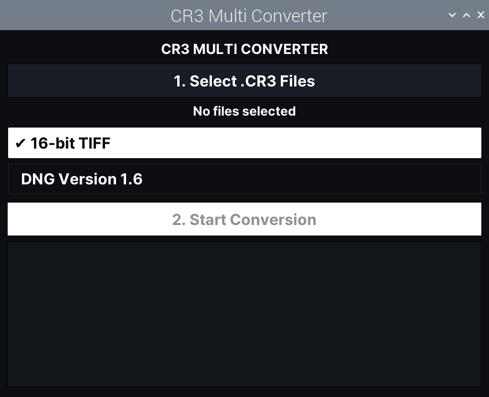

# CR3 Multi Converter for Raspberry Pi

A graphical Python (Tkinter) application designed for touchscreen use on Raspberry Pi OS. It converts `.CR3` files in batch (for example from a Canon EOS R50V or any other Canon camera supported by `dnglab`) into:

* **DNG Version 1.6** (via `dnglab`)
* **16-bit TIFF** with white balance and the original metadata preserved (via `dcraw` and `exiftool`)

## Why this tool?

I wanted an easy way to process raw Canon `.CR3` files (like those from a Canon EOS R50V) directly on a Raspberry Pi running Raspberry Pi OS, because Canon's official software has no native version for Linux or ARM CPUs.

RAW editors do not always help either: in our testing, Darktable 5.6.2 (Flatpak, bundling LibRaw 0.22.0) did not work with `.CR3` files from the Canon EOS R50 V. This tool converts `.CR3` files to DNG or TIFF so they can be opened by any editor. Support in RAW editors may improve with newer LibRaw releases.

<p align="center">
  <br>
  
  <br>
</p>

## System Requirements

* `dnglab`
* `dcraw`
* `libimage-exiftool-perl`
* Python 3 with the Tkinter library
* Google **Inter** font

## Files (in order of operation)

| Step | File | Purpose |
|------|------|---------|
| 1 | `install.sh` | Installs the command-line tools and the Inter font |
| 2 | `cr3_to_dng.py` | Main graphical application |
| 3 | `cr3_converter.desktop` | Adds the app to the Raspberry Pi OS applications menu |
| 4 | `README.md` | This guide |

All files live in the `~/cr3-multi-converter/` folder: the menu entry (`cr3_converter.desktop`) launches the app from there.

## Quick Installation

### Option A: clone the repository

```bash
cd ~
git clone https://github.com/flavioscutti/cr3-multi-converter.git
cd cr3-multi-converter
chmod +x install.sh
./install.sh
mkdir -p ~/.local/share/applications
cp cr3_converter.desktop ~/.local/share/applications/
```

Test the app:

```bash
python3 ~/cr3-multi-converter/cr3_to_dng.py
```

### Option B: create the files manually with Mousepad

Open each file in Mousepad, paste the content of the matching file from this repository, then save.

First create the folder:

```bash
mkdir -p ~/cr3-multi-converter
```

**Step 1: installation script**

```bash
mousepad ~/cr3-multi-converter/install.sh &
```

After saving, make it executable and run it:

```bash
chmod +x ~/cr3-multi-converter/install.sh
~/cr3-multi-converter/install.sh
```

If `dnglab` is not found, download the binary from the [dnglab releases page](https://github.com/dnglab/dnglab/releases) and place it in `/usr/local/bin/`, then make it executable:

```bash
sudo chmod +x /usr/local/bin/dnglab
```

**Step 2: main application**

```bash
mousepad ~/cr3-multi-converter/cr3_to_dng.py &
```

After saving, test it:

```bash
python3 ~/cr3-multi-converter/cr3_to_dng.py
```

**Step 3: applications menu entry**

```bash
mkdir -p ~/.local/share/applications
mousepad ~/.local/share/applications/cr3_converter.desktop &
```

After saving, the app appears in the Graphics or Utility category of the system menu. If it does not show up right away, log out and back in.

**Step 4: README (optional)**

```bash
mousepad ~/cr3-multi-converter/README.md &
```

## Usage

1. Click **1. Select .CR3 Files** and choose one or more files (the dialog supports folder navigation and multiple selection).
2. Toggle the output formats you want: **16-bit TIFF** and/or **DNG Version 1.6**.
3. Click **2. Start Conversion**. Progress and errors appear in the log area.

Converted files are saved next to the originals. If a file with the same name already exists, a numeric suffix is added (`_1`, `_2`, ...).

## Compatibility

The app does not hard-code any camera-specific values: resolution, color matrix and sensor pattern are read by `dnglab` from each file. Any Canon `.CR3` file supported by your installed version of `dnglab` should work. If a camera is not supported yet, the log shows an `[ERROR] dnglab` message and the app moves on to the next file. In that case, update `dnglab`.

Check your installed version with:

```bash
dnglab --version
```

## Notes

* Conversion of very large files can take a while on slower boards: each external tool call has a timeout (120 s for `dnglab` and `dcraw`, 60 s for `exiftool`). You can raise these values in `cr3_to_dng.py` if needed.
* The interface uses the **Inter** font; if it is not installed, Tkinter falls back to a default font.

## Other Linux Distributions

While the application is tailored for Raspberry Pi OS (ARM), it can also run on other Linux distributions (such as Ubuntu or Debian on x86_64 PCs), as long as Python 3, Tkinter and the required tools are available.

**1. Install the system tools (Ubuntu / Debian):**

```bash
sudo apt update
sudo apt install dcraw libimage-exiftool-perl python3-tk fonts-inter
```

On other distributions, install the equivalent packages for `dcraw`, `exiftool` and Python Tkinter with your package manager.

**2. Install `dnglab`:**

Download the binary for your architecture from the [dnglab releases page](https://github.com/dnglab/dnglab/releases), place it in `/usr/local/bin/` and make it executable:

```bash
sudo chmod +x /usr/local/bin/dnglab
```

**3. Run the app:**

```bash
python3 ~/cr3-multi-converter/cr3_to_dng.py
```
  ## Disclaimer

  This is an independent, unofficial project. It is not affiliated with,
  endorsed by or sponsored by Canon Inc. Canon and EOS are trademarks of
  Canon Inc.
